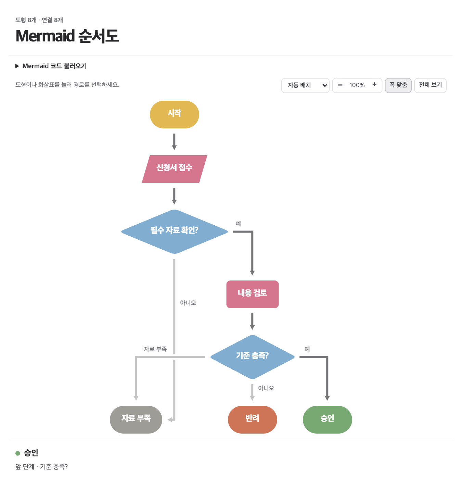
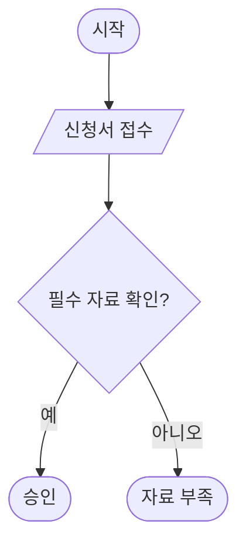

# Mermaid Flowchart Navigator

Obsidian 노트나 독립 HTML 뷰어에서 Mermaid 순서도의 경로를 따라갈 수 있습니다. 도형이나 화살표를 누르면 해당 경로가 강조됩니다. 긴 순서도는 앞뒤 단계를 보면서 선택지를 하나씩 따라갈 수 있습니다. 두 뷰어 모두 오프라인에서 동작하며 화면은 한국어입니다.

[English guide](README.md)

## Obsidian에 설치하기

Obsidian의 **설정 → 커뮤니티 플러그인 → 둘러보기**에서 **Mermaid Flowchart Navigator**를 검색한 뒤 **설치 → 활성화**를 선택하세요. [커뮤니티 플러그인 페이지](https://community.obsidian.md/plugins/mermaid-flow-viewer)

### ZIP으로 직접 설치하기

1. [최신 설치 ZIP](https://github.com/yuyu04/mermaid-flowchart-navigator/releases/latest/download/mermaid-flowchart-navigator.zip)을 내려받아 압축을 풉니다.
2. 안에 있는 `mermaid-flow-viewer` 폴더를 사용할 볼트의 `.obsidian/plugins/`에 넣습니다. 설치하면 `.obsidian/plugins/mermaid-flow-viewer/manifest.json`이 생깁니다.
3. Obsidian을 다시 열고 **설정 → 커뮤니티 플러그인**에서 **Mermaid Flowchart Navigator**를 켭니다.

이전 **Mermaid Flow Viewer**에서 업데이트할 때는 같은 폴더에 새 파일을 덮어쓰면 기존 설정을 이어서 쓸 수 있습니다.

## 노트에서 사용하기

일반 `mermaid` 코드 블록에 `flowchart` 또는 `graph`를 작성하고 읽기 보기나 라이브 미리보기에서 확인하세요. 시퀀스 다이어그램 같은 다른 도표는 Obsidian의 기본 보기로 열립니다. 명령 팔레트에서 **Mermaid 흐름 뷰어 열기**를 선택하면 현재 순서도를 별도 창에서 볼 수 있습니다.

~~~~markdown

~~~~

- **경로 선택** — 도형이나 화살표를 누르면 선택한 경로가 진해집니다. 여러 갈래가 한 결과에 모이면 결과 도형을 눌러 들어오는 경로를 고를 수 있습니다.
- **자세히 읽기** — 마우스를 올리거나 키보드로 도형에 초점을 맞추면 전체 이름과 설명이 열립니다. 터치 화면에서는 도형을 누르세요.
- **단계별 보기** — 도형이 15개 이상이면 이 보기로 시작합니다. 흐린 도형은 지나온 단계와 선택지 다음에 올 단계입니다. 선명한 선택지를 눌러 진행하고 **이전** 또는 **처음**으로 돌아갈 수 있습니다.
- **배치와 크기** — **자동 배치**는 원래 방향을 따릅니다. **세로 배치**는 위에서 아래로, **폭 맞춤**은 현재 노트의 가로 폭에 맞춰 보여 줍니다. **전체 보기**와 **− / +**로 배율을 조절할 수 있습니다.

방향을 지정한 연결, 분기 라벨, 합류, 되돌아가는 연결을 읽습니다. 같은 ID의 도형은 하나로 표시하며 하위 그룹은 펼쳐서 보여 줍니다. 결과 도형은 `:::success`, `:::failure`, `:::unknown`으로 구분할 수 있습니다. 일반 Mermaid 블록에 방향 없는 선, 자기 자신을 가리키는 선 등 지원 범위 밖의 표현이 있으면 원래 도표가 표시됩니다.

## 브라우저와 HTML에서 사용하기

[독립형 viewer.html](https://github.com/yuyu04/mermaid-flowchart-navigator/releases/latest/download/viewer.html)을 내려받아 브라우저에서 여세요. **Mermaid 코드 불러오기**에 코드를 붙여 넣고 **순서도로 변환**을 누르면 됩니다. 브라우저에서 직접 가져올 때는 `sequenceDiagram`의 메시지와 분기도 순서도로 읽을 수 있습니다.

다른 웹페이지에 넣으려면 해당 페이지 옆에 `viewer.html`을 두고, 아래처럼 프레임이 열린 뒤 Mermaid 원문을 전달하세요.

~~~~html
<iframe id="flow" title="신청서 검토 순서도" style="width:100%;height:680px;border:0"></iframe>

~~~~

## 소스에서 빌드하기

`python3 build.py`를 실행하면 `dist/`에 `viewer.html`, 설치 ZIP, Obsidian에 복사할 `mermaid-flow-viewer/` 폴더가 생깁니다. Python 표준 라이브러리만 사용합니다. 함께 배포하는 Mermaid 11.12.0 문법 분석기와 Dagre 3.1.4의 라이선스를 확인할 수 있습니다. [Mermaid](vendor/mermaid-LICENSE.txt) · [Dagre와 graphlib](vendor/dagre-LICENSE.txt)

이 플러그인과 독립 HTML 뷰어는 MIT 라이선스로 배포합니다. [MIT License](LICENSE)
