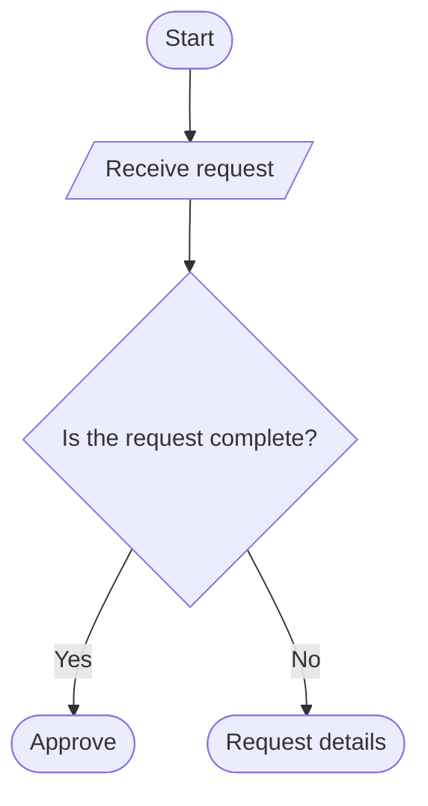
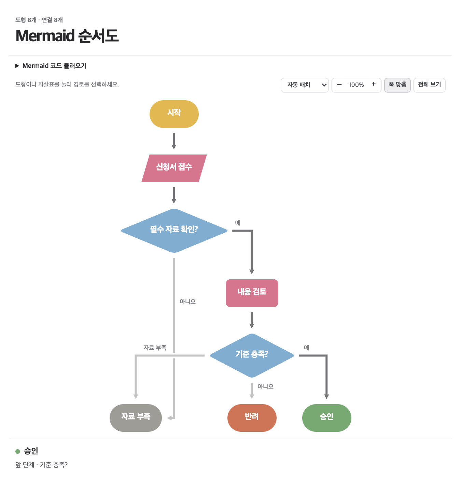

# Mermaid Flowchart Navigator

Follow a path through a Mermaid flowchart in an Obsidian note. Click a decision or an arrow to see how you reached an outcome. On long charts, you can move through one decision at a time with the previous and upcoming steps in view. The viewer works offline and its controls are in Korean.

[한국어 사용 안내](README.ko.md)

## Installation

In Obsidian, open **Settings → Community plugins → Browse**. Search for **Mermaid Flowchart Navigator**, open its entry, then select **Install** and **Enable**. [Obsidian Community listing](https://community.obsidian.md/plugins/mermaid-flow-viewer)

### Manual installation

1. Download and extract the [plugin ZIP](https://github.com/yuyu04/mermaid-flowchart-navigator/releases/latest/download/mermaid-flowchart-navigator.zip).
2. Copy the extracted `mermaid-flow-viewer` folder into your vault’s `.obsidian/plugins/` folder. You should now have `.obsidian/plugins/mermaid-flow-viewer/manifest.json`.
3. Restart Obsidian, open **Settings → Community plugins**, and enable **Mermaid Flowchart Navigator**.

If you previously installed **Mermaid Flow Viewer**, copy the new files into the same plugin folder to keep your settings.

## Usage

Paste this block into a note. Switch to **Reading view**, or move the cursor outside the code block in **Live Preview**.

~~~~markdown

~~~~

Click the **Yes** arrow to highlight the path from **Start** to **Approve**. Click **Request details** to follow the other branch. Hover over a node or focus it with the keyboard to read its full label and description. On a touch screen, tap the node.



- **Step through large charts.** A flowchart with 15 or more nodes opens in **단계별 보기** (step-by-step view). Select an answer to move forward. The faded nodes show nearby steps. Use **이전** to go back or **처음** to return to the first decision.
- **Adjust the view.** Choose **세로 배치** for a top-to-bottom layout. Use **폭 맞춤** to fit the note width, **전체 보기** to fit the entire chart, or **− / +** to zoom.
- **Open a separate viewer.** In the command palette, search for **Mermaid 흐름 뷰어 열기**. If the note has several flowcharts, you can choose which one to open.

The plugin reads `flowchart` and `graph` blocks. Obsidian displays sequence diagrams and other diagram types in its built-in viewer. Use `:::success`, `:::failure`, or `:::unknown` on a result node to set its outcome color. Arrows that point to the same node ID converge on that node.

## Standalone HTML viewer

Download [viewer.html](https://github.com/yuyu04/mermaid-flowchart-navigator/releases/latest/download/viewer.html) and open it in a browser. Choose **Mermaid 코드 불러오기** (load Mermaid code), paste your diagram, then select **순서도로 변환** (render flowchart). The standalone importer can also turn the messages and branches of a `sequenceDiagram` into a flowchart.

To embed the viewer in a web page, place `viewer.html` beside the page and send the Mermaid source after the frame loads.

```html
<iframe id="flow" title="Request review" style="width:100%;height:680px;border:0"></iframe>
<script>
  const frame = document.getElementById("flow");
  frame.addEventListener("load", () => {
    const source = "flowchart LR\n  A([Start]) --> B[Review] --> C([Approve]):::success";
    const origin = location.protocol === "file:" ? "*" : location.origin;
    frame.contentWindow.postMessage({ type: "mermaid-flow:render", source }, origin);
  });
  frame.src = "./viewer.html";
</script>
```

## Build from source

Run `python3 build.py` from the repository root. It uses the Python standard library and writes the standalone HTML file, the install ZIP, and the `mermaid-flow-viewer/` plugin folder under `dist/`.

## License

The plugin and standalone viewer are distributed under the [MIT License](LICENSE). The bundled parsers are from Mermaid 11.12.0, and the layout engine is Dagre 3.1.4. [Mermaid license](vendor/mermaid-LICENSE.txt) · [Dagre and graphlib licenses](vendor/dagre-LICENSE.txt)
